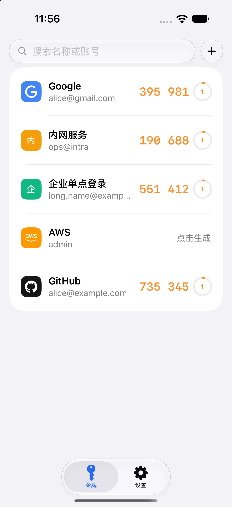
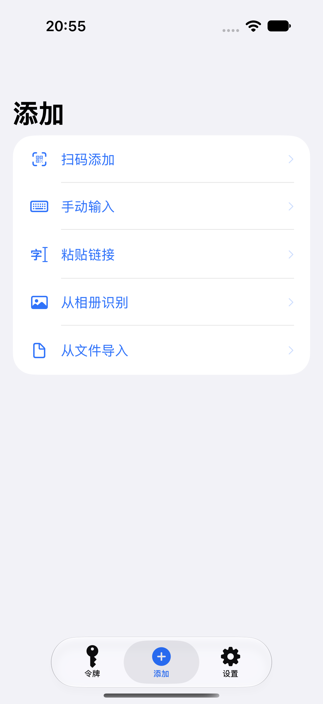
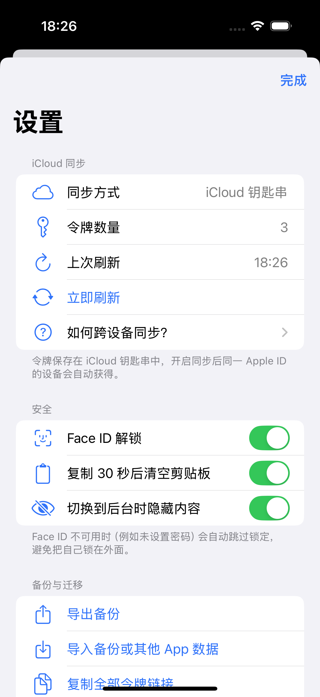
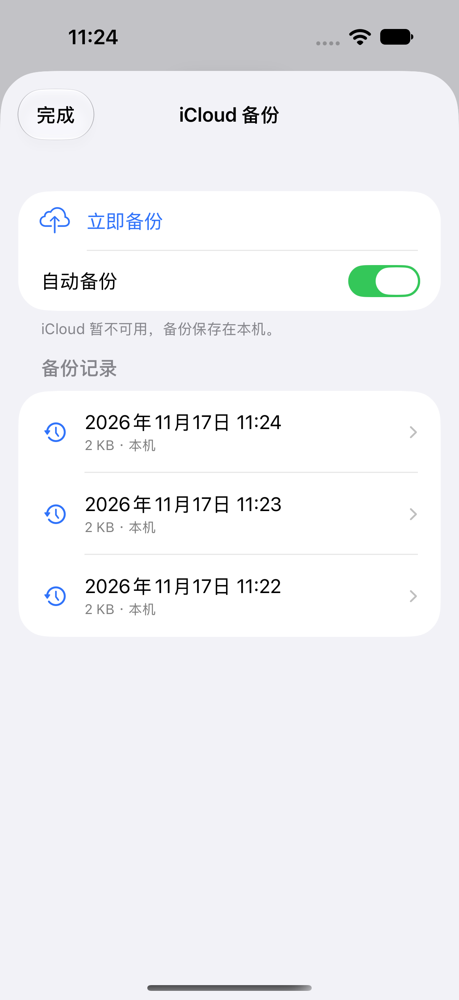
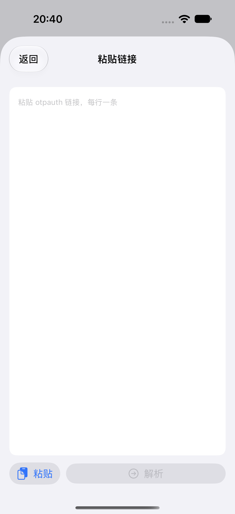
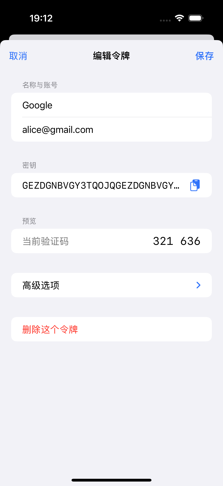
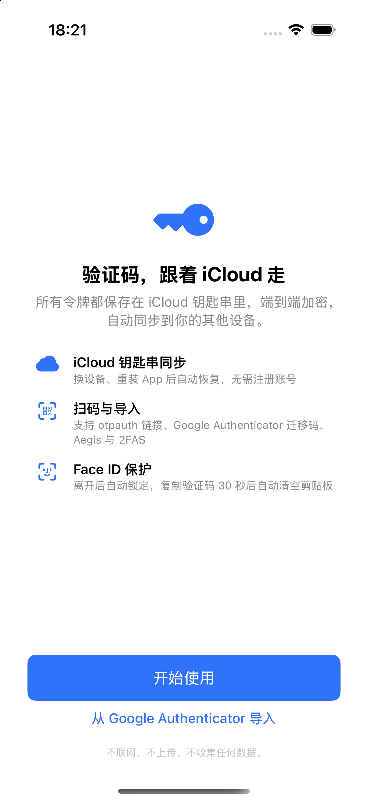
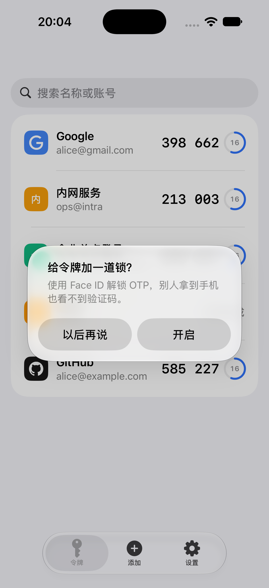

# OTP · iOS 原生令牌管理器

一款数据只放在 **iCloud 钥匙串** 里的 OTP 认证器：端到端加密、自动同步、可备份可迁移。底部两个标签页（令牌 / 设置），添加按钮在搜索栏右侧，点一下验证码就复制。

<p>
  
  
  
  
</p>
<p>
  
  
  
  
</p>

## 特性

- **TOTP / HOTP**：SHA-1/256/512，6–8 位，自定义周期与计数器，符合 RFC 4226 / RFC 6238。
- **零学习成本**：点行复制验证码（触觉反馈 + 剪贴板定时清空），长按编辑 / 置顶 / 二维码 / 删除；验证码与倒计时环横排，秒数在环内，超长名称自动横向滚动。
- **图标**：内置 40+ 常用品牌（GitHub、Google、Microsoft、AWS、Slack、Discord、微信、支付宝等），按名称或邮箱域名自动识别；没有匹配时用名称首字生成彩色头像，也可以从相册上传自定义图标。
- **iCloud 同步**：每条令牌是 iCloud 钥匙串里的一条端到端加密记录，换机、重装后自动回来。
- **添加方式**：扫码、手动输入、粘贴 otpauth 链接、从相册识别二维码、导入文件。
- **迁移**：Google Authenticator 迁移码、Aegis（未加密）、2FAS（未加密）、本 App 备份、任意 otpauth 链接。
- **备份**：手动或自动备份到 iCloud Drive（`OTP/Backups`，最多 10 份），列表里一键恢复，支持增量合并、更新同项、完全替换；也可以导出 AES-256-GCM 加密的 `.otpbackup`（PBKDF2-HMAC-SHA256，210,000 次迭代）、未加密 JSON 或单条二维码。
- **保护**：Face ID / iPhone 密码解锁（3 个令牌或使用 5 天后主动询问一次；开启时先完成一次验证，成功后才生效）、切后台遮挡、剪贴板定时过期；不可用时自动跳过锁定。
- **无网络**：App 不发起任何请求，没有分析或第三方 SDK。

## 快速开始

要求：Xcode 27+、iOS 18.0+（已在 **iOS 27.2 模拟器** 与 iOS 18.5 上验证）、[XcodeGen](https://github.com/yonaskolb/XcodeGen)（`brew install xcodegen`）。

```bash
scripts/bootstrap.sh      # 由 project.yml 生成 OTP.xcodeproj
open OTP.xcodeproj        # 选择模拟器或真机运行
```

命令行构建与测试（默认 iPhone 18 Pro / iOS 27.2 模拟器）：

```bash
scripts/build.sh
scripts/test.sh
scripts/run-simulator.sh
```

模拟器里同样可以完整使用钥匙串（工程带 `OTP.entitlements`，用 ad-hoc 签名）。扫码需要真机摄像头；模拟器请用「从相册识别」或「粘贴链接」。

## 在真机上运行

1. Xcode → OTP target → Signing & Capabilities，选择你的 Team（仓库里预填了 `BCRZR3P4AP`）。
2. iCloud 备份需要 iCloud Documents 能力：工程已经在 `OTP/OTP.entitlements` 里配置 `iCloud.com.carljoy.otp`，并在 `Info.plist` 里声明 `NSUbiquitousContainers`；同步本身仍然走 iCloud 钥匙串，不依赖 CloudKit。
3. 免费开发者账号也能运行（签名 7 天有效期）；长期使用建议付费开发者计划。
4. 如果需要改 Bundle ID，请同时确认 `OTP/OTP.entitlements` 里的 `keychain-access-groups` 跟着改；钥匙串 service 常量 `cn.carljoy.otp.token` 与 Bundle ID 无关，改名不会丢数据。

## 数据是怎么同步的

每个令牌 = 一条 `kSecClassGenericPassword` 记录：

```
service     = cn.carljoy.otp.token
account     = <令牌 UUID>
synchronizable = true
accessible  = kSecAttrAccessibleAfterFirstUnlock
value       = JSON（见下）
```

```json
{"v":1,"id":"UUID","issuer":"GitHub","account":"alice","kind":"totp","algo":"sha1",
 "digits":6,"period":30,"counter":0,"secret":"JBSWY3DPEHPK3PXP","pinned":false,
 "createdAt":"2026-11-16T10:00:00.000Z","updatedAt":"2026-11-16T10:00:00.000Z"}
```

- 没有本地数据库：钥匙串就是唯一真源，内存里只保留只读快照。
- 删除条目即删除，删除会随 iCloud 钥匙串同步到其他设备。
- App 会剔除读不懂的记录（旧版本 / 新版本 / 损坏），并在列表顶部提示数量。
- 卸载 App **不会**删除钥匙串条目；只有在 App 内「清空所有令牌」才会删除。

同步需要满足：

- 所有设备登录同一 Apple ID、开启双重认证、开启「iCloud 钥匙串」（设置 → 你的名字 → iCloud → 密码与钥匙串），并设置锁屏密码。
- 同步时机由系统决定，App 无法读取同步状态；回到前台、下拉刷新会重新读本机钥匙串。
- 同一个令牌在两台离线设备上被编辑时，系统按「最后写入者胜出」处理，App 不做字段级合并。
- 新设备安装后如果没有立刻出现数据，稍等片刻后下拉刷新；仍未出现请检查上面的开关。

## 备份与迁移

「设置 → iCloud 备份」：

- **立即备份 / 自动备份**：加密后保存到 iCloud Drive 的 `OTP/Backups`，最多保留 10 份；开启自动备份后，令牌有变化并切到后台时会自动补一份。
- **列表恢复**：点备份记录 → 选择恢复方式 → 恢复。列表显示备份时间、大小和来源（iCloud / 本机）。
  - **增量合并**：只添加当前没有的令牌，已有令牌保持不动。
  - **更新同项**：同一条目用备份内容更新，并补充缺失的令牌。
  - **完全替换**：先自动保存一份当前状态作为安全副本，再删除当前令牌并用备份替换。
- **导出备份**：默认用密码加密（至少 8 位）。生成后通过系统文件面板保存到 iCloud Drive、AirDrop 出去或发给自己的微信。
- **导入备份**：选择文件 → 自动识别格式 → 预览 → 勾选后导入；已存在的相同令牌默认不勾选。
- **复制令牌链接**：把 `otpauth://` 明文列表放进剪贴板（60 秒后过期），适合粘贴到其他认证器。
- **单条二维码**：令牌长按 → 显示二维码，可分享或保存图片。

加密备份格式（v1）：

```json
{"format":"otp-backup","version":1,"createdAt":"2026-11-16T10:00:00.000Z","encrypted":true,
 "kdf":{"algorithm":"pbkdf2-hmac-sha256","iterations":210000,"salt":"base64"},
 "cipher":{"algorithm":"aes-256-gcm","nonce":"base64"},
 "ciphertext":"base64","tag":"base64"}
```

密文里是同样的明文信封结构（含 `tokens` 数组）。未加密备份就是 `encrypted:false` + 直接内嵌 `tokens`。**密码不会保存在设备上，忘记后无法恢复。**

导入支持：

| 来源 | 方式 | 说明 |
|---|---|---|
| 任意 App | `otpauth://` 单条 / 多行 | 完整支持 |
| Google Authenticator | 迁移二维码 / `otpauth-migration://` | 支持（MD5 条目会跳过） |
| Aegis | JSON 文件 | 仅未加密导出 |
| 2FAS | JSON 文件 | 仅未加密导出 |
| 本 App | `.otpbackup`（加密或明文） | 完整支持 |
| 其他 | 包含 otpauth 链接的文本文件 | 逐行解析 |
| Steam Guard | — | 暂不支持 |

## 安全设计

- 密钥只存在钥匙串；UserDefaults 只存 UI 偏好（锁开关、上次备份时间、引导标记）。
- 备份加密：PBKDF2-HMAC-SHA256（210,000 次、16 字节随机盐）派生 32 字节密钥，AES-256-GCM 加密并校验 tag；错误密码与文件损坏无法区分，统一报错。
- iCloud 备份使用保存在 iCloud 钥匙串中的随机 32 字节密钥（随 Apple ID 同步），恢复时无需输入密码；导出的 `.otpbackup` 仍使用你设置的密码。
- 复制验证码时设置剪贴板过期时间（默认 30 秒，可在设置关闭）。
- 解锁使用 `.deviceOwnerAuthentication`：优先 Face ID / Touch ID，自动回退到设备密码；从后台返回超过 60 秒才重新锁定。
- 切到后台时全屏遮挡；验证码文本标了 `.privacySensitive()`。

## 项目结构

```
project.yml                  XcodeGen 工程描述（构建配置的唯一来源）
OTP/
  App/                       入口、根视图、启动参数（测试/截图用）
  Models/                    令牌模型、算法、错误类型
  Core/Crypto/               Base32、HOTP、TOTP、验证码分组
  Core/URI/                  otpauth:// 解析与生成
  Core/Storage/              钥匙串仓库、TokenStore actor、内存实现
  Core/Backup/               备份信封、PBKDF2 + AES-GCM、iCloud 文件存储、恢复模式
  Core/Import/               Protobuf、Google 迁移码、Aegis、2FAS、URI 列表
  Core/Support/              ISO8601、启动配置
  Features/Tokens/           列表、行、编辑、二维码、品牌图标、添加弹窗
  Features/Import/           导入流程与预览
  Features/Scanner/          VisionKit 扫码、相册识别
  Features/Settings/         设置、iCloud 备份列表、恢复、导出
  Features/Lock/             Face ID 锁
  Features/Onboarding/       首次启动引导
  DesignSystem/              剪贴板、倒计时环、滚动文字、图标处理、二维码渲染
  Resources/                 Info.plist、隐私清单、Assets、着色
OTP/Resources/BrandIcons/   内置品牌图标（白色字形，运行时着色）
OTPTests/                    单元测试（Swift Testing）
OTPUITests/                  UI 测试（XCTest）
scripts/                     bootstrap / build / test / run / screenshot / verify-totp
```

## 开发与测试

单元测试覆盖：

- RFC 4226 全部 10 组 HOTP 向量、RFC 6238 SHA-1/256/512 全部 TOTP 向量、Base32 向量与容错。
- otpauth 解析 / 序列化往返、异常参数；令牌 JSON 编解码、版本与损坏数据处理。
- 备份明文/加密往返、错误密码、篡改、版本过新、PBKDF2 已知向量。
- Google Authenticator Protobuf（含未知字段、截断）、Aegis、2FAS、多行链接。
- 真实钥匙串集成（synchronizable 条目增删改查、服务隔离、损坏记录跳过）。
- 列表排序 / 去重 / 批量导入 / HOTP 计数器递增 / 二维码渲染。
- 品牌识别（含中文与邮箱域名）、内置图标资源完整性、图标缩放压缩、自定义图标随令牌存储。

UI 测试覆盖：手动添加 → 出现验证码 → 点击复制 → 重启后仍在；粘贴链接导入；长按清空；iCloud 备份列表与恢复流程。

```bash
scripts/test.sh
python3 scripts/verify-totp.py JBSWY3DPEHPK3PXP   # 与 App 同秒对比，独立实现
```

调试用启动参数（DEBUG 构建）：

- `-uiTestService <name>`：使用独立钥匙串 service，避免污染真实数据。
- `-demoService <name> -seedDemo`：写入 3 个示例令牌并跳过引导，用于截图。
- 上述任一参数会同时关闭 Face ID 锁与首次引导。

### 数据存在哪里

令牌是 **iCloud 钥匙串** 里的同步条目（service `cn.carljoy.otp.token`），端到端加密。它们**不会**出现在 iCloud 云盘、iCloud 设置或「密码」App 的第三方条目列表中——这是 Apple 对第三方钥匙串项的限制，不是没有同步。在两台登录同一 Apple ID 且开启 iCloud 钥匙串的设备上打开 OTP，即可看到同步结果；备份文件会出现在 iCloud 云盘 → OTP → Backups；令牌本身不会。

### 安装到真机

项目使用自动签名，把 `project.yml` 里的 `DEVELOPMENT_TEAM` 换成你自己的 Team ID，然后：

```bash
xcodebuild -project OTP.xcodeproj -scheme OTP -configuration Release \
  -destination 'id=<设备 UDID>' -allowProvisioningUpdates build
xcrun devicectl device install app --device <设备 UDID> \
  <DerivedData>/Build/Products/Release-iphoneos/OTP.app
```

Release 构建不会写入任何演示数据；开发描述文件通常有效期一年，到期前用同样命令重新安装即可。

## 已知限制

- 同步依赖系统 iCloud 钥匙串；关闭时 App 仍可本机使用，但不会跨设备同步，且无法检测状态。
- 没有 Widget、Apple Watch、分享扩展；没有手动拖拽排序（置顶 + 字母序）；品牌图标为单色字形 + 品牌色底，不是官方彩色 Logo。
- 不支持 Steam Guard、加密的 Aegis / 2FAS 备份、MD5 算法。
- iPad 以 iPhone 兼容模式运行；界面仅简体中文。
- 同一令牌多端并发编辑时可能出现「最后写入者胜出」，不提供合并。

## 设计取舍

选择 **iCloud 钥匙串作为存储与同步层**，而不是 CloudKit：

- Apple 端到端加密，服务器端看不到密钥；无需 CloudKit 容器、schema 与付费开发者能力。
- 删除天然同步，不需要墓碑或同步引擎；本机没有第二份明文数据库。
- 代价是同步时机由系统控制、无法读取同步状态、冲突只能整条覆盖。
- `TokenRepository` 协议把存储与 UI 解耦：如果将来要换 CloudKit 或本地 SwiftData，只需要新增一个实现。

## 隐私

App 不联网、不收集任何数据、不包含第三方 SDK。备份文件由用户自行保存与分享；二维码和明文备份都包含密钥，请谨慎处理。

## 许可

个人项目，未提供开源许可证；如需使用请先联系作者。